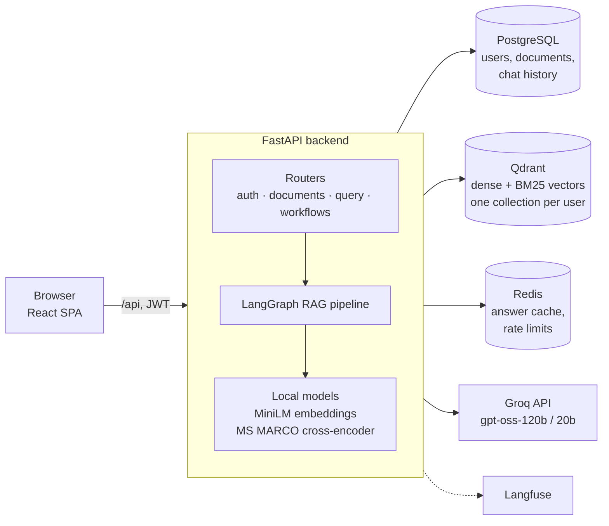

<p align="center">
  
</p>

<h1 align="center">DocuBrain</h1>

<p align="center">
  Chat with your PDFs, extract invoice data, compare documents and summarize them.<br/>
  Every answer is grounded in your documents and cites the exact passages it came from.
</p>

<p align="center">
  <a href="https://github.com/spasovskibojan/DocuBrain/actions/workflows/main.yml"></a>
  
  
  
  
  
</p>

---

## Features

**Document chat**
- Ask questions across all your documents or scope the chat to a single one.
- Answers carry inline `[n]` citations; each one links to the source passage with its file name and page number.
- If retrieval finds nothing relevant, the assistant says so instead of answering from general knowledge.
- Follow-up questions work: "what about the second one?" is rewritten into a standalone question using the last turns of the conversation, and requests like "make it shorter" reformat the previous answer without a new search.

**Workflows**
- **Invoice extractor** returns vendor, date, total and tax as JSON validated against a Pydantic schema. Invalid output is sent back to the model with the validation error for one retry.
- **Compare documents** lists what changed between two documents, such as two versions of a contract, referring to each by its file name.
- **Executive brief** produces a three-point summary of a document.

**Platform**
- JWT authentication; every user has an isolated vector collection and can only read or delete their own documents.
- Per-user rate limiting on AI endpoints and per-IP limiting on login and registration.
- Repeated questions are answered from a Redis cache, invalidated when the user's documents change.
- Langfuse tracing of every request (pipeline steps, prompts, latency, token usage), enabled by setting the Langfuse keys.

---

## Architecture



### Ingestion


1. The upload is checked for extension, size and the `%PDF-` header.
2. `pdfplumber` extracts text page by page; each page is split into 900-character chunks with 150 overlap, so every chunk keeps its page number. The size fits the 256-token input limit of the embedding model.
3. Each chunk is stored in Qdrant with two vectors: a 384-dim `all-MiniLM-L6-v2` embedding and a BM25 sparse vector computed by the Qdrant server.
4. If any step fails, the document row is removed so the database never lists a document without vectors.

### Question answering


Dense search finds passages by meaning ("payment deadline" matches "due within 30 days"). BM25 finds exact terms that embeddings handle poorly, such as invoice numbers and company names. Both run in a single Qdrant query and are merged with Reciprocal Rank Fusion before the cross-encoder picks the final five.

### Workflows


Workflows skip retrieval: they read the document's chunks directly by index. Invoices use the first and last chunks (vendor at the top, totals at the bottom); briefs and comparisons sample chunks evenly across the document.

### Engineering notes

- **Document title in search text.** Chunks are embedded and reranked with the file name prepended, so a clause like "99.5% availability" still matches a question about "the 2025 agreement". The stored text stays clean.
- **Self-correcting retrieval.** When the best reranked chunk scores below a threshold, the graph rewrites the query once and searches again before generating.
- **Prompt context grouped by document.** Retrieved passages are grouped per document and put back in reading order, so the model does not mix facts between two similar contracts.
- **Cache invalidation by version.** Cache keys include a per-user version number. Uploading or deleting a document increments it, which makes all old answers unreachable without scanning keys.
- **Redis fails open.** If Redis is unavailable, cache and rate limiting are skipped and requests still succeed; the readiness probe checks only Postgres and Qdrant.
- **Safe migrations with replicas.** Alembic runs on startup under a Postgres advisory lock, so two backend replicas starting together do not migrate at the same time.
- **Models baked into the image.** The embedding and reranker models are downloaded at build time and the container runs with `HF_HUB_OFFLINE=1`, so pods start without network access to Hugging Face.

---

## Tech stack

| Layer | Technology |
|---|---|
| Backend | FastAPI, async SQLAlchemy 2, asyncpg, Alembic, Pydantic v2 |
| AI pipeline | LangGraph, LangChain, Groq (`openai/gpt-oss-120b` for answers and workflows, `openai/gpt-oss-20b` for query rewriting) |
| Retrieval | Qdrant hybrid search (dense + BM25, RRF), Sentence Transformers `all-MiniLM-L6-v2`, cross-encoder `ms-marco-MiniLM-L-6-v2` |
| Data | PostgreSQL 16 (JSONB for cited sources in chat history), Redis 7 |
| Observability | Langfuse |
| Auth | JWT (`python-jose`), bcrypt |
| Frontend | React 19, Vite, React Router, React Bootstrap, `react-markdown` |
| Infrastructure | Docker, Docker Compose, Kubernetes (k3d), Traefik Ingress, nginx, GitHub Actions |

---

## Getting started

**Requirements:** Docker with Docker Compose and a free [Groq API key](https://console.groq.com).

```bash
git clone https://github.com/spasovskibojan/DocuBrain.git
cd DocuBrain
```

Create a `.env` file in the project root:

```env
GROQ_API_KEY=your_key_here
SECRET_KEY=any_long_random_string

# Optional: tracing in Langfuse Cloud
LANGFUSE_PUBLIC_KEY=pk-lf-...
LANGFUSE_SECRET_KEY=sk-lf-...
```

```bash
docker compose up --build -d
```

| Service | URL |
|---|---|
| App | http://localhost:5173 |
| API docs (Swagger) | http://localhost:8000/docs |
| Qdrant dashboard | http://localhost:6333/dashboard |

The first build takes a few minutes because it downloads the CPU build of PyTorch and both models into the image.

To run the whole stack on a local Kubernetes cluster instead, see [docs/deployment.md](docs/deployment.md), which also covers configuration and CI/CD.

---

## Testing

```bash
docker compose exec backend pytest tests/ -v
```

35 tests run against a real PostgreSQL database, with Qdrant and the LLM replaced by fakes, so the suite needs no API keys. They cover auth and rate limiting, upload validation, isolation between users, RAG routing and hybrid search, and the retry logic of the invoice extractor. GitHub Actions runs them on every push and pull request, then builds and pushes the Docker images on `main`.

---

## Project structure

```
├── backend/
│   ├── app/
│   │   ├── api/          # auth, documents, query, workflows routers
│   │   ├── core/         # config, database, security, Redis client, tracing
│   │   ├── models/       # SQLAlchemy models
│   │   ├── schemas/      # Pydantic schemas
│   │   └── services/     # RAG pipeline, embeddings, reranker, Qdrant, PDF parsing
│   ├── alembic/          # database migrations
│   └── tests/
├── frontend/src/
│   ├── pages/
│   ├── components/
│   └── services/         # Axios client with JWT interceptor
├── k8s/                  # Kubernetes manifests and start/stop scripts
└── docs/
```

---

## Limitations

- Only text-based PDFs are supported; scanned documents are rejected because there is no OCR step.
- To stay within the Groq free-tier limit of 6,000 tokens per minute, workflows on long documents read a sample of chunks instead of the full text. Typical invoices are short enough to be read in full; summaries and comparisons of longer documents can miss content.
- CORS is open to all origins; it should be restricted to the frontend domain before a public deployment.
